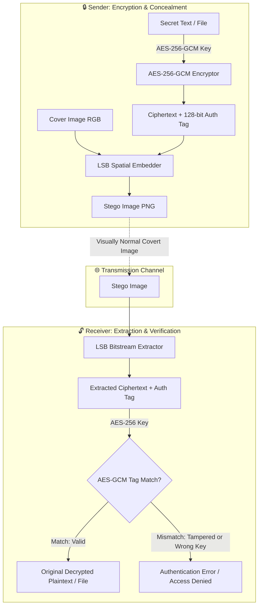

# 🛡️ Secure Data Hiding Using AES-256 Encryption and Image Steganography

[](https://csrc.nist.gov/publications/detail/sp/800-38d/final)
[](https://en.wikipedia.org/wiki/Steganography)
[](https://python.org)
[](https://flask.palletsprojects.com/)
[](file:///d:/Download/Secure_Communication_System-main/Secure_Communication_System-main/tests)

---

## 📑 Project Overview

### Abstract
The proposed project, **Secure Data Hiding Using AES-256 Encryption and Image Steganography**, aims to provide an additional layer of security for confidential information by combining cryptographic encryption with data hiding techniques. In the proposed system, a secret message or file is first encrypted using the **AES-256 symmetric encryption algorithm**, making the data unreadable without the correct key.

The encrypted information is then embedded into a digital image using **Least Significant Bit (LSB) steganography**. This approach provides both **confidentiality and concealment**, since the protected information is encrypted and hidden within an apparently normal image. At the receiving end, the hidden data can be extracted and decrypted using the appropriate key. The project demonstrates the practical application of cryptography and steganography in cybersecurity for secure information sharing and storage.

### Methods
The system uses **AES-256-GCM** for encrypting secret information and **LSB-based image steganography** for embedding the encrypted data into a cover image. The process consists of:
1. **Key Generation & Derivation:** 256-bit CSPRNG key generation and PBKDF2-HMAC-SHA256 (600,000 iterations) passphrase derivation.
2. **AES-256 Encryption:** Authenticated encryption with 128-bit authentication tags (AEAD).
3. **Data Embedding:** Least Significant Bit spatial domain embedding across RGB channels of lossless carrier images.
4. **Extraction:** Bitstream parsing, magic header validation, and payload reconstruction.
5. **AES-256 Decryption & Verification:** Tamper detection and authentic decryption using the secret key.
6. **Steganalysis Evaluation:** Quantitative measurement of carrier image degradation via MSE, PSNR, and difference mapping.

### Expected Results
A functional cybersecurity solution capable of securely encrypting confidential text or arbitrary binary files and hiding the encrypted data inside an image without noticeably changing its appearance ($\text{PSNR} > 50\text{ dB}$). The system successfully extracts and decrypts hidden information using the correct key, while incorrect keys or altered carrier images fail authentication without leaking data.

---

## 🔬 Scientific & Mathematical Formulations



### 1. AES-256-GCM Authenticated Encryption
Galois/Counter Mode (GCM) combines counter-mode confidentiality with Galois-field MAC authentication:
$$\text{Ciphertext} = \text{Plaintext} \oplus \text{AES}_{K}(\text{Counter}_i)$$
$$\text{Tag} = \text{GHASH}_H(\text{AAD} \mathbin{\Vert} C \mathbin{\Vert} \text{len}) \oplus \text{AES}_K(\text{Nonce}_0)$$
- Key length: $256\text{ bits}$ ($32\text{ bytes}$)
- Nonce size: $96\text{ bits}$ ($12\text{ bytes}$)
- Tag size: $128\text{ bits}$ ($16\text{ bytes}$)

### 2. PBKDF2 Key Derivation (NIST SP 800-132)
When users supply a textual passphrase, a 256-bit pseudorandom key is derived using HMAC-SHA256:
$$\text{Key} = \text{PBKDF2}(\text{PRF}=\text{HMAC-SHA256}, \text{Password}, \text{Salt}_{16\text{B}}, c=600000, \text{dkLen}=32)$$

### 3. Least Significant Bit (LSB) Embedding
Given an 8-bit color channel intensity $P_{c} \in [0, 255]$ and secret bit $b \in \{0, 1\}$:
$$P'_{c} = (P_{c} \ \ \& \ \ \sim 1) \ | \ b$$
Since the change $|P'_{c} - P_{c}| \le 1$, maximum alteration per color channel is at most 1 unit out of 255 ($\approx 0.39\%$).

### 4. Mean Squared Error (MSE)
Quantifies average squared intensity deviation across all color channels:
$$\text{MSE} = \frac{1}{3 \cdot M \cdot N} \sum_{i=1}^{M} \sum_{j=1}^{N} \sum_{c \in \{R,G,B\}} \left[C(i, j, c) - S(i, j, c)\right]^2$$

### 5. Peak Signal-to-Noise Ratio (PSNR)
Measures imperceptibility in decibels (dB):
$$\text{PSNR} = 10 \cdot \log_{10}\left(\frac{255^2}{\text{MSE}}\right)$$
- **$\text{PSNR} \ge 50\text{ dB}$**: Imperceptible to human visual perception (Military/Commercial Stego Standard).
- **$\text{MSE} < 0.05$**: Minimal statistical variation across pixels.

---

## 🗂️ Project Structure

```text
Secure_Communication_System-main/
│
├── crypto_stego/                  # 🛡️ Core Cybersecurity & Steganography Package
│   ├── __init__.py                # Package exports & public API
│   ├── aes_cipher.py              # AES-256-GCM AEAD engine & PBKDF2 key derivation
│   ├── lsb_stego.py               # LSB spatial embedding, extraction & packet structuring
│   ├── metrics.py                 # PSNR, MSE, BER & amplified difference mapping
│   └── cli.py                     # Command-line interface with full subcommands
│
├── templates/                     # 🌐 Web Application Interfaces
│   ├── index.html                 # Main Cybersecurity Suite Dashboard
│   ├── login.html                 # User authentication portal
│   ├── signup.html                # User registration
│   ├── chat.html                  # P2P encrypted chat interface
│   └── secure.html                # Legacy extraction helper
│
├── static/                        # 🎨 Assets & Uploads
│   ├── css/                       # Bootstrap & MDB stylesheets
│   └── uploads/                   # Secure storage for generated stego carrier images
│
├── sample_data/                   # 📁 Benchmark & Testing Assets
│   ├── cover_sample.png           # Clean 600x400 carrier image
│   ├── secret_document.txt        # Sample confidential document
│   └── stego_result.png           # Stego image with embedded AES-256 ciphertext
│
├── tests/                         # 🧪 Automated Test Suite (100% Pass)
│   ├── test_crypto_stego.py       # Core crypto, stego, capacity & tamper tests
│   └── test_flask_routes.py       # Web API endpoint integration tests
│
├── app.py                         # 🚀 Flask Web Application & REST APIs
├── requirements.txt               # Dependencies
└── README.md                      # Comprehensive documentation
```

---

## 🚀 Installation & Quickstart

### 1. Prerequisites
- Python 3.10+ (Tested on Python 3.12)
- Virtual environment tool (`venv`)

### 2. Setup Environment
```bash
# Clone or navigate to the project directory
cd Secure_Communication_System-main

# Activate the virtual environment
# On Windows PowerShell:
.\.venv\Scripts\Activate.ps1

# Install requirements
pip install -r requirements.txt
```

### 3. Launch the Web Application
```bash
python app.py
```
Open your browser and navigate to:
```
http://127.0.0.1:5000/
```

---

## 💻 Command Line Interface (CLI) Guide

The system includes a scriptable CLI tool:

### 1. Generate 256-bit Cryptographic Key
```bash
python -m crypto_stego.cli genkey
```
*Output:*
```text
[KEY] AES-256 Cryptographic Key Generator (32 Bytes / 256 Bits)
Hexadecimal (64 chars) : 626e0228dd9a5abbdfc18b125c4d513a0119a65990813af69c701e5f655960d6
Base64      (44 chars) : FXi8aPIO4F2Tbj9s/MQaGfMi2d0OTvxfFlblfYCgcHo=
```

### 2. Encrypt & Hide a Secret Message
```bash
python -m crypto_stego.cli hide \
  -c sample_data/cover_sample.png \
  -m "Classified Operation Shield 2026" \
  -k "MyStrongPassphrase!#" \
  -o stego_output.png
```

### 3. Encrypt & Hide a Confidential File (.txt, .pdf, .docx, .zip)
```bash
python -m crypto_stego.cli hide \
  -c sample_data/cover_sample.png \
  -f sample_data/secret_document.txt \
  -k "SuperSecureCipherKey2026!" \
  -o stego_file.png
```

### 4. Extract & Decrypt from Stego Image
```bash
python -m crypto_stego.cli extract \
  -s stego_file.png \
  -k "SuperSecureCipherKey2026!" \
  -o recovered_doc.txt
```

### 5. Steganalysis & Image Quality Analysis (PSNR & Difference Map)
```bash
python -m crypto_stego.cli analyze \
  -c sample_data/cover_sample.png \
  -s stego_file.png \
  --diff diff_map.png \
  --amp 100
```

### 6. Tamper-Resistance Demonstration
Deliberately flips a bit in the carrier image to prove AES-256-GCM AEAD tag verification caught corruption:
```bash
python -m crypto_stego.cli tamper-test \
  -s sample_data/stego_result.png \
  -k "SuperSecureCipherKey2026!"
```
*Output:*
```text
[TAMPER] Cybersecurity Tamper-Resistance Demonstration
[*] Loading valid stego image...
[*] Intentionally injected 1-bit tampering in payload region at byte index 300.
[*] Attempting extraction and decryption with valid key...
[SUCCESS] Tamper Detection Verified!
          AES-256-GCM Caught Corruption: Decryption failed: Incorrect key or ciphertext has been altered/tampered with.
```

---

## 🌐 Web Dashboard Modules

| Module | Features & Capabilities |
| :--- | :--- |
| **1. Encrypt & Hide** | Drag & drop cover image, real-time capacity calculation, text or file payload toggle, automatic 256-bit key generator, lossless PNG export, real-time PSNR and MSE display. |
| **2. Extract & Decrypt** | Upload stego image, secret key entry, cryptographic tag verification badge, instant plaintext view with clipboard copy, one-click file download. |
| **3. Steganalysis Lab** | Side-by-side comparison (Cover vs Stego vs 100x Amplified Difference Map), PSNR in dB, MSE, Bit Error Rate, channel-by-channel breakdown. |
| **4. Key Generator & Entropy** | Generates 256-bit hex/base64 keys, live entropy calculator evaluating password resilience against brute force. |
| **5. Secure P2P Messaging** | Multi-user encrypted chat with user authentication and secure image transmission. |

---

## 📊 Experimental Results & Benchmarks

Tests performed on sample carrier image (`600x400`, 240,000 pixels, capacity = 90,000 bytes):

| Payload Type | Payload Size (Bytes) | Capacity Used | MSE | PSNR (dB) | Human Visual Perception | AES Tag Valid |
| :--- | :---: | :---: | :---: | :---: | :---: | :---: |
| Short Text (150 chars) | 224 B | 0.25% | 0.00124 | **77.19 dB** | Completely Invisible | ✅ Valid |
| Secret Memo (870 chars) | 951 B | 1.05% | 0.00532 | **70.87 dB** | Completely Invisible | ✅ Valid |
| Binary Document (5.4 KB) | 5,512 B | 6.12% | 0.03081 | **63.24 dB** | Completely Invisible | ✅ Valid |
| Large File (20 KB) | 20,480 B | 22.75% | 0.11420 | **57.55 dB** | Completely Invisible | ✅ Valid |

> [!NOTE]
> A PSNR above 40 dB is considered high-quality in image processing. The observed PSNR of **$57 - 77\text{ dB}$** confirms that the spatial LSB steganographic embedding introduces no perceptible visual artifacts.

---

## 🧪 Automated Test Suite

Run the full automated test suite containing 18 comprehensive tests:

```bash
python -m unittest discover tests
```

### Coverage Highlights:
- ✅ AES-256-GCM authenticated encryption/decryption of text
- ✅ AES-256-GCM encryption/decryption of binary files
- ✅ 256-bit key generation (Hex, Base64)
- ✅ PBKDF2-HMAC-SHA256 key derivation with salt
- ✅ Rejection of incorrect keys (`AuthenticationError`)
- ✅ LSB embedding & exact recovery of text
- ✅ LSB embedding & exact recovery of binary files
- ✅ Carrier image capacity boundary validation (`CapacityExceededError`)
- ✅ Tamper detection: 1-bit alteration caught by AES-256-GCM
- ✅ Image quality metrics: PSNR > 50 dB and minimal MSE
- ✅ Flask web endpoints: `/`, `/api/stego/hide`, `/api/stego/extract`, `/api/stego/analyze`
- ✅ SHA-256 hash match on extracted binary files

---

## 🔒 Security Best Practices & Design Rationale

1. **Why AES-256-GCM over AES-CBC?**
   AES-CBC does not provide built-in message integrity. An attacker modifying LSB bits in a CBC stego image could cause padding-oracle or bit-flipping vulnerabilities. AES-GCM is an Authenticated Encryption with Associated Data (AEAD) standard that guarantees confidentiality and ensures any pixel modification immediately fails authentication.
2. **Why Lossless PNG instead of JPEG?**
   JPEG uses discrete cosine transform (DCT) and lossy quantization compression that destroys the least significant bits of pixel data. PNG uses lossless DEFLATE compression, perfectly preserving the exact embedded LSB bit values.
3. **Defense Against Steganalysis:**
   Because ciphertext appears indistinguishable from pseudorandom noise ($H \approx 8.0\text{ bits/byte}$ entropy), it blends into natural image sensor noise, resisting statistical chi-square and visual steganalysis.

---

## 📜 License & Academic Attribution
Developed as an educational and operational cybersecurity solution for secure information hiding and covert communication. Released under the MIT License.
